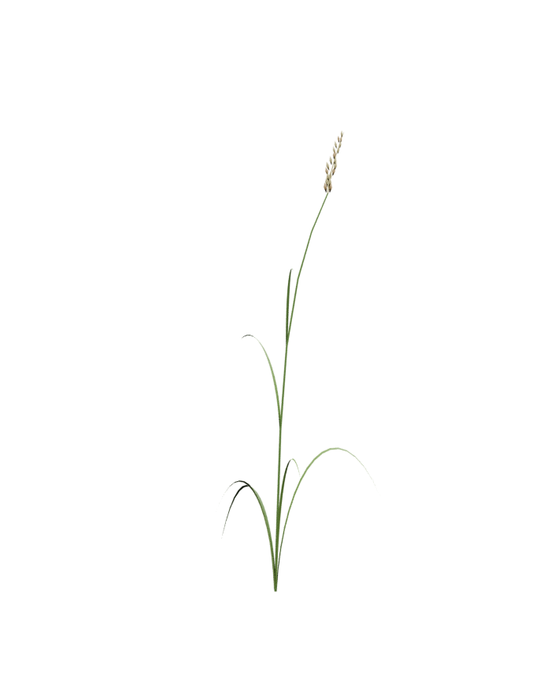
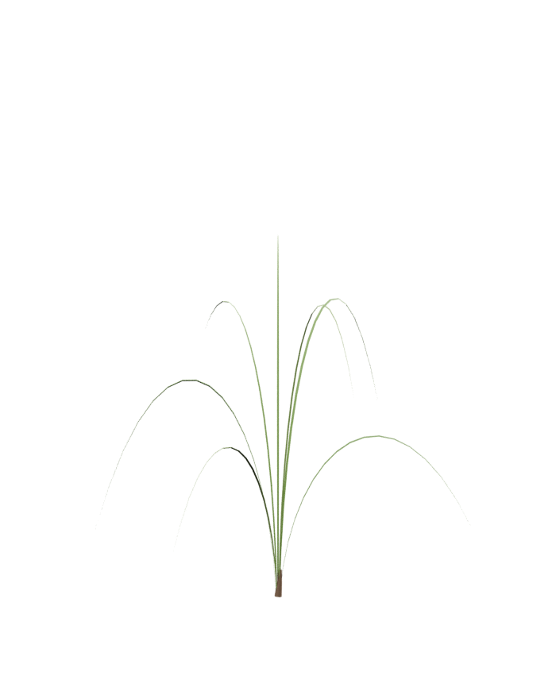
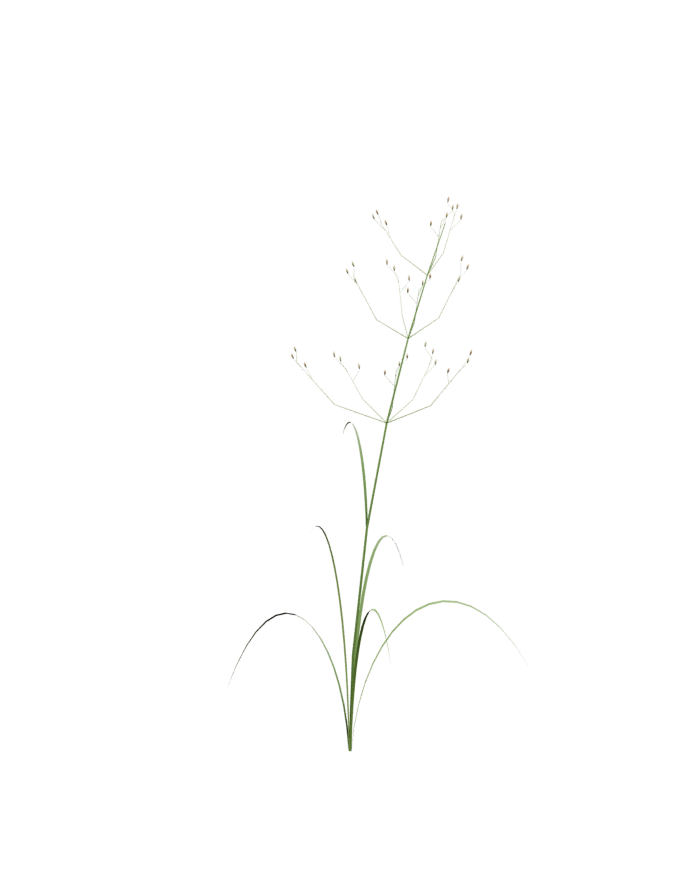

# Hellesylt 草地單體原型

Refs #29、#30。這輪在改草地前，先用三個原創單體檢查草的比例、葉姿和穗形。每個樣本只有一個植株生長點或一根開花草莖。第一輪的決策是選形，後續才會看整片草地的密度、地皮與手機成本。

## 生態與照片

| 來源 | 取用重點 |
| --- | --- |
| 需求提出者提供的五張照片 | 圖 1 看草坡的細葉交疊、圖 2 看草叢與鬆散花序、圖 3 看村地低垂的細葉、圖 4 看面積覆蓋和低對比的地表、圖 5 看一小部分窄而微彎的穗形。 |
| Geiranger／Vesterås 乾草甸 | 同在 Stranda。現地調查的第 30 頁圖 5、6 記錄了三種原型混生的草層，第 51、52 頁看整片坡地與地被。當地傳統草甸以季末割草為主，部分地塊有春秋放牧。這支持草坡在割前存在低密草層與更高花莖。[NIBIO 調查照片與說明](https://kudos.dfo.no/documents/48747/files/31174.pdf#page=30) |
| Frøysadal 放牧地 | Hellesylt 周邊的樣地記錄到黃花茅在多處占優勢。這是區域內可以出現成片黃花茅的證據。遊戲第一輪以少量花莖點綴草坡是畫面設定。[Bioreg 報告第 19、26 頁](https://www.bioreg.no/wp-content/uploads/2022/10/2008/2008-40.pdf#page=19) |
| Hellesylt 村地和 Stranda 放牧坡地 | 村地拍攝取屋前短草與路緣，坡地拍攝取草覆蓋與岩石的空間關係。村地視覺設定為較低、被管理過的短草。草坡設定為割前混生草甸。[村地全景](https://commons.wikimedia.org/wiki/File:Residential_of_Hellesylt_and_Sunnylven_kyrkje,_Stranda,_M%C3%B8re_og_Romsdal,_Norway,_2025_May.jpg) · [NIBIO 坡地照片](https://nibio.no/tema/landskap/utmarksbeite/nytt-fra-utmarksbeite) |

NIBIO 將紫羊茅、細弱剪股穎和黃花茅列為自然放牧地常見草種。長期放牧的草地通常以禾草為主，維護良好的乾草甸常有較多草本。地圖內的物種比例、葉長分布和覆蓋率仍待現地量測。本輪採用區域內已記錄的組合，比例由畫面設計決定。[NIBIO 自然放牧地](https://nibio.no/tema/landskap/kulturlandskap-og-biologisk-mangfold/kulturmarkstyper/naturbeitemark) · [挪威生物多樣性資料庫乾草甸](https://artsdatabanken.no/Pages/138110)

## 單體盲審

[打開匿名預覽](grass-specimens/preview.html)。HTML 和同資料夾的 PNG 可一起放在本機開啟。每張圖只有一個生長點，使用相同燈光和正交相機、兩個相差約 94° 的視角。樣本各自取景，請用 GLB 的公尺座標比尺寸。先看完 A、B、C，再揭曉下方的物種標籤。

| A | B | C |
| --- | --- | --- |
|  |  |  |
| [A 側視](grass-specimens/A-side.png) · [A GLB](grass-specimens/A.glb) | [B 側視](grass-specimens/B-side.png) · [B GLB](grass-specimens/B.glb) | [C 側視](grass-specimens/C-side.png) · [C GLB](grass-specimens/C.glb) |

每樣分開看三件事。葉片有沒有從基部細細長出並自然收尖。從另一側看，外輪廓是否仍像薄葉。花莖與穗頭的比例能不能讓整根保持纖細。滿場時的草量、黑點和移動閃爍會在後面的群落樣片另行驗收。

<details>
<summary>揭曉物種、尺寸和造型取捨</summary>

| 樣本 | 實物依據與原型 |
| --- | --- |
| A，黃花茅 <i>Anthoxanthum odoratum</i> | GrassBase 記錄葉寬通常 1.5–5 mm、花序通常 1–12 cm 長及 6–15 mm 寬。原型用約 4.3 cm 的狹穗，保留連續細軸和少量重疊的淡金色小穗。草莖末段略偏向一側，葉片以較低處為主。[Kew GrassBase](https://powo.science.kew.org/taxon/urn:lsid:ipni.org:names:389034-1/general-information) |
| B，紫羊茅 <i>Festuca rubra</i> | GrassBase 記錄絲狀折葉多為 0.5–1 mm 寬，較寬個體可到 2 mm。原型是一個營養枝，葉片朝幾個方向彎垂，可用來檢查村地需要的細葉與柔和輪廓。[Kew GrassBase](https://powo.science.kew.org/taxon/urn:lsid:ipni.org:names:30010036-2/general-information) |
| C，細弱剪股穎 <i>Agrostis capillaris</i> | GrassBase 記錄葉寬 1–5 mm，花序開展，小穗長 2–3.5 mm。原型以略寬的窄葉和分枝間有空隙的鬆花序，表現草坡單株的疏展形狀。[Kew GrassBase](https://powo.science.kew.org/taxon/urn:lsid:ipni.org:names:30197865-2/general-information) |

</details>

## 技術方案

- 單株用公尺座標、三次 Bézier 中線和有窄折脊的雙面葉片。葉片由中線與左右緣構成，寬度隨位置收至同一尖點。穗梗沿細管走向，穗頭用分枝和小穗的實體幾何描述輪廓。原型在 Blender 以固定種子建模，輸出 glTF 2.0 和相同幾何的兩視角渲染。
- 進遊戲時優先沿用 three.js／TSL 的 GPU 實例畫法。在近景保留折脊和長短不同的葉形，將複雜花序放在很小的近景範圍。薄葉接近亞像素時，以草叢覆蓋交接到中景卡片，再由地表草冠接遠景。保持草根與輪廓在 LOD 前後對得上。
- 草冠的顏色從葉片底色和自然土色混合而來。先用同鏡頭拆開草幾何、草冠、地表著色來查黑點，再用低對比、連續的地表明暗做驗收。密度分布參考照片中與道路、岩緣及坡度一起變化的覆蓋。
- 現有的中畫質預算仍可用來約束群落實驗：草坡 8.4 m 路徑最多 250,000 草三角形、3 次草地繪製。單株幾何與圖示是候選形狀，後續會另做具體的精簡 LOD 和 POCO 實測。

可從儲存庫根目錄用 Blender 4.3 重建這六張圖與三個 GLB：

```sh
blender -b -t 3 --python-exit-code 1 -P docs/research/grass-specimens/build.py -- /tmp/grass-specimens
```

## 品質記錄

單體以葉形與草莖比例來審。A 的彎莖和窄穗輪廓清楚，小穗間距仍略整齊。B 的葉寬最接近低矮細草的目標，某些側視葉尖需要在手機上驗證時間穩定性。C 的開展花序可和 A 分辨，側視時細分枝的對比偏低。群落密度、近遠交接、黑點和移動閃爍列為場景樣片的驗收條件。

`npm run dev -- --strictPort` 啟動後，[渲染管線檢查頁](grass-specimens/renderer-check.html) 可用本專案的 three.js 讀入三個 GLB。從 Vite 開啟 `/world-unbound/docs/research/grass-specimens/renderer-check.html?backend=webgpu` 或同一路徑的 `?backend=webgl2`，確認實際 backend、包圍盒高度、幾何和渲染三角形數。
