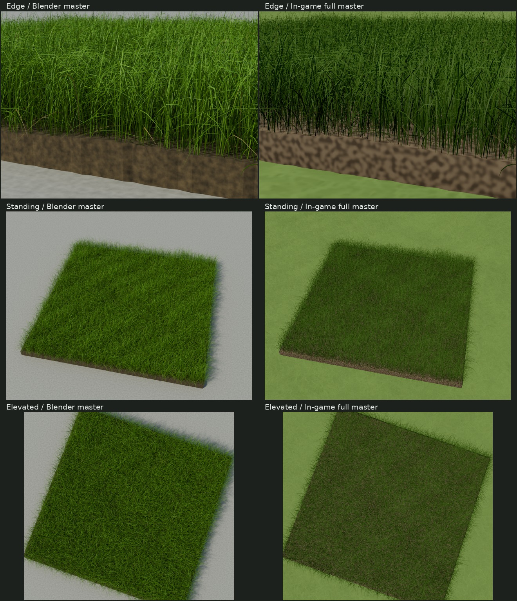
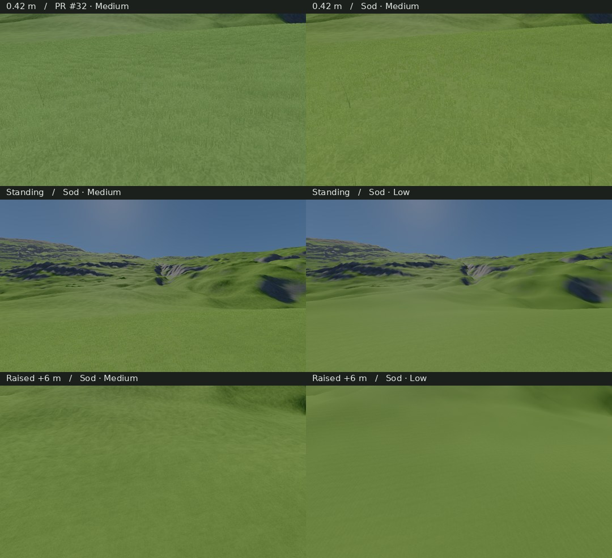

# G2.1 草皮高模進場

範圍經使用者核准「直接鋪上，然後實作規則一起開 PR」。由已確認的一公尺草皮高模抽取近景葉形，側投影中景草簇，以及俯視草絨。只對現有 CDLOD 草地遮罩生效，舊草層可用 `sward=0` 回復。Low 採用單次取樣的同一草絨，Medium 與 High 沿用實體葉、草簇與遠景草絨的分層。

初次遊戲對照後，使用者要求「跟高模差太多，直接拿高模用吧」。**原模直接繪製**已加入同一支 PR。前三段 LOD 的畫面保留作歷史對照。

## 原模直接繪製

- 使用 `?sod=full&sodView=edge`，可改成 `standing`、`elevated` 或 `backlight`。進入遊戲 cam 2，於相同鏡頭座標與焦距看一塊一平方公尺的原始草皮。`backlight` 對應原模的鏡頭角度，遊戲日照由 `hour` 設定。畫布長寬比分別為 1100∶800、1060∶810、1060∶950、1160∶790。
- 從已核准的 `.blend` 直接匯入 79,524 片葉、1,510,956 個頂點、1,749,528 個草葉三角形與全部 20,800 個根毯三角形。每片葉的拓撲、位置、法線和 Float32 葉色都保留。座標做 Z-up 到 Y-up 的軸轉換，整塊平移到實際遊戲地形。草絨下方保留遊戲地面。
- 遊戲用自己的日照、曝光、陰影和即時材質。草葉材質取原模葉色，加即時的近根遮蔽、雙面與透光近似，根毯取原模土層模型並重建土色和粗糙度。保留原模靜態葉形控制比較條件。
- 普通啟動不請求 36.4 MiB 的原模檔。原模模式測一塊完整模型，單塊的草葉三角形是舊 Medium 草叢幾何峰值的 7.6 倍，幾何緩衝區在 CPU 和 GPU 各約 72.4 MiB。手機 WebGPU 與多塊鋪設的負荷尚未測量。

```sh
blender -b /tmp/world-unbound-sod/fescue-sod.blend -t 2 --python-exit-code 1 -P tools/bake-sod.py -- full assets/grass/sod-full.bin
```



對照於 Chromium 156／SwiftShader WebGL2 使用 Medium、`scale=1`、13:00 擷取。三個畫面都報告完整 1,749,528 個草葉三角形，地面與草坡接地陰影仍比攝影棚背景重，俯視細葉有取樣顆粒。

- 從 Blender 高模定稿抽取幾何與線性色彩，保留原始米制。輸入由 `tools/build-sod.py` 重建。由 `tools/bake-sod.py` 產出近景、中景和遠景資產。
- 載入、草種遮罩和形變沿用現有渲染，保留花穗模型、地形路徑、清楚標示的 WebGL2 備援和除錯回退。URL 預設 `sward=1`，`sward=0` 是傳統草層，`grass=0` 關閉草層。
- 驗收以實拍為基準，取貼地、站姿和抬升鏡頭。獨立記錄即時版損失的葉形、厚度、透光和幀時間。使用原有快速檢查、視覺稽核及遊戲入口。

## 實物對照與產製

使用者提供的實拍為草密度和輪廓基準。取細羊茅型草皮的窄葉、弧度和葉尖交錯做一公尺方形試片，另對照果嶺的整片覆蓋及逆光葉緣。參考亦包括 [Shadowmeld Photography 的近拍](https://commons.wikimedia.org/wiki/File:Common_Lawn_Grass_Macro_PLT-GR-3.jpg)、[Royal Zoute GC 的果嶺照片](https://commons.wikimedia.org/wiki/File:Putting_green.jpg)和 [Ramani Marimuthu 的逆光照片](https://commons.wikimedia.org/wiki/File:Green_Blades_and_Sunbeams.jpg)。

| 資產 | 產製內容 |
| --- | --- |
| `sod-near.bin` | 取中央一簇真實尺寸的七片葉，重採樣成 126 個三角形。 |
| `sod-side.bin` | 從 27 cm × 1.1 cm 草皮切片投影，烘焙 512 × 256 RG8 輪廓與葉色。側投影沿坡度貼地，邊緣有羽化。 |
| `sod-top.bin` | 從一公尺模型頂部採樣，烘焙 512 × 512 RGBA8 葉色、高度和葉向。高度通道約 99.996% 的像素有葉；這是烘焙覆蓋率。 |

Blender 4.3.2；烘焙端使用 Python 3、NumPy 2.3.5、Pillow 13.0.0。可用以下方式重新產製並比較 `assets/grass/sod-*.bin`。第一步指定 `--views edge,standing,elevated,backlight` 可另存各視角母模截圖。

```sh
blender -b -t 2 --python-exit-code 1 -P tools/build-sod.py -- /tmp/world-unbound-sod --views ''
blender -b /tmp/world-unbound-sod/fescue-sod.blend -t 2 --python-exit-code 1 -P tools/bake-sod.py -- extract /tmp/world-unbound-sod/sod.npz
python3 tools/bake-sod.py /tmp/world-unbound-sod/sod.npz /tmp/world-unbound-sod/grass
```

高模有 79,524 片葉。遊戲在近處只繪製經取樣的葉簇，其餘密度透過側投影和底層草絨呈現。512 × 512 俯視圖獨立請求，原始資料 1 MiB，隨啟動時的地形處理平行載入。手機幀時間和熱機表現待真機驗證。葉尖透光與草根接地仍由 [Issue #33](https://github.com/waydefu/world-unbound/issues/33)追蹤。

## 前版 LOD 畫面與預算



本地 Chromium／SwiftShader WebGL2，`cam=2&walk=1&scale=1&hud=0`。在同一個起點定格風與曝光，截取貼地 0.42 m、站姿和相對站姿抬升 6 m。對照組為 #32 的 `sward=1` 草皮，Low 使用同一份俯視烘焙圖。Low 截圖仍少了個別葉形和細緻的絨毛明暗。

- Medium 以原有兩個長寬比各抽樣 25 個走位，三角形峰值均為 230,468，草批次至多 3，與 #32 同測法一致。
- Low 檢查站姿與升高鏡頭，草皮啟用且草幾何為 0 個三角形。此處記錄的是幾何量，地表 shader 仍有每像素成本。
