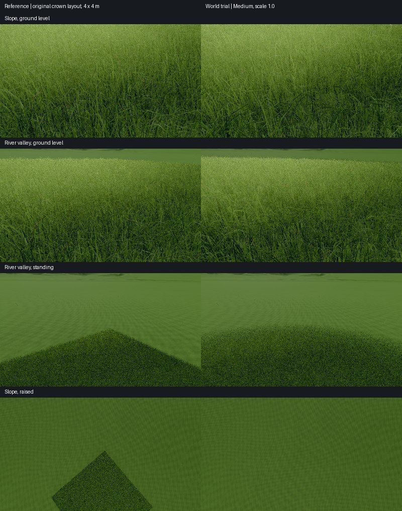
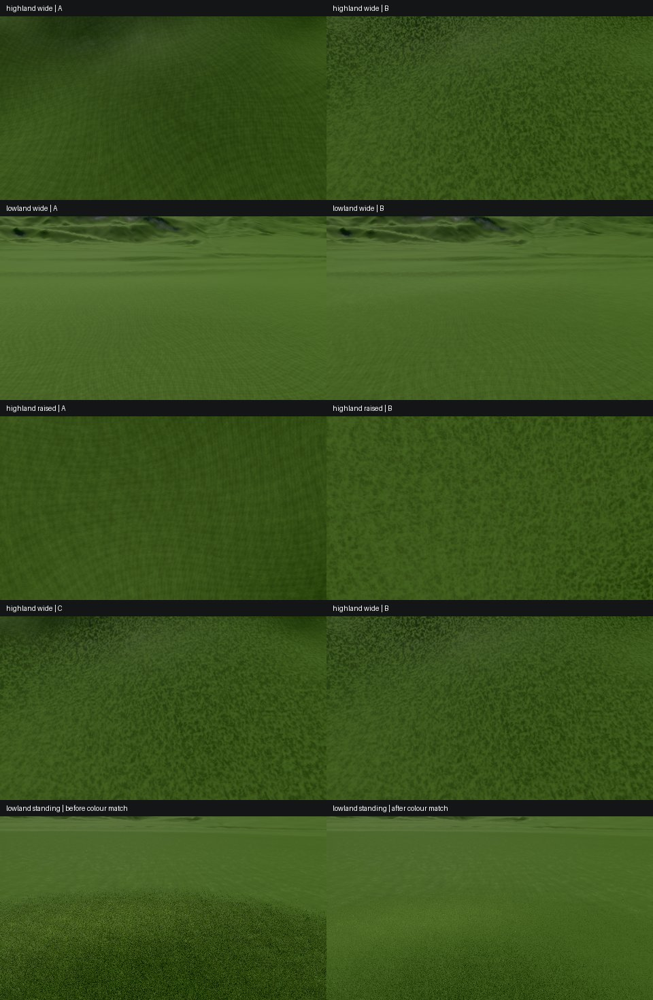
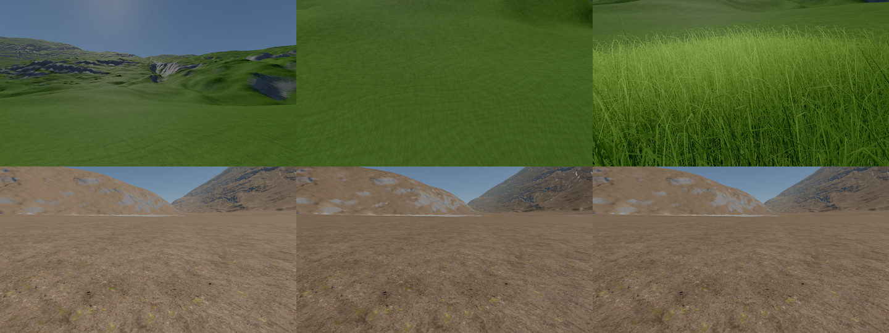

# S1 連續草地與土壤

在 Hellesylt CDLOD 地圖的草甸及可生長坡面，以核准原模和實拍驗收草地。實物資料附實際來源與適用尺度，現場未知的數值記為模型假設。

## 全域草毯驗收

使用者於 2026-11-21 確認全圖採同一品質標準。現有版本的近景密草圈和圈外平綠地已判定未達標。

- **範圍與密度。** 整張地圖可生長的土面都要有連續底層草毯。以核准的完整 1 m² 高模及其 **79,524 葉／m²** 為標準。以沿地表量得的實際面積計算，任選完整落在草地內的 1 m² 都應呈現同級的草量與厚度，包含跨地形格線或載入區塊的樣區。草花按各自品種疊在底層草毯上。
- **近看與遠看。** 在地圖各處貼近觀察應看到原模的細葉輪廓、彎曲、綠色及扎在土面的草根。從腳邊到遠坡都應看得出同一片高密度草毯的厚度、覆蓋感和風吹起伏。近景成圈、遠處變成平綠地、接縫露出稀草或移動時密度跳變，任何一項都判定未達標。
- **驗收畫面。** 用一般遊戲入口比對核准高模和實拍。取相隔的河谷、坡地和高地草區，各拍貼地、站姿及抬升。保存地點、相機高度、畫質、曝光、光照和風設置。同一場景再以錄影或連續畫格跨過細節切換和載入邊界。密度抽樣列出同一批實際 1 m² 區域的葉數與範圍。
- **效能與判定。** 先用畫面對照確認全視野的草地品質，再量測最佳化的影響。視野外可以裁切或動態載入。視野內的細節切換必須以相同鏡頭證明仍維持核准的草毯外觀。單塊展示及標稱密度各自用於檢查資產及參數。全域結果依實際遊戲畫面與使用者驗收判定，手機幀時間另記。

[核准的 1 m² 原模與遊戲對照](g2.1-real-turf-field.md#原模直接繪製) · [視覺審查流程](../process/visual-review.md#worldwide-turf-acceptance)

## 全域草毯試玩

以 `?sward=world&cam=6&q=med` 進入試玩。`?sward=baseline` 回到現行草地，`?sward=0` 使用舊程序草。`?sod=full` 查看完整母版。

- `turfSite=slope|lowland|highland|seam` 固定驗收地點，世界座標依序為 (20, −40)、(684, 444)、(−660, 492)、(0, −40)。最後一點位於輸入地形的磁磚縫。`turfView=close|standing|raised` 指定離地 0.16、1.2、7.2 m 的角度。`turfReference=1` 在 4 × 4 m 的展示範圍內繪製全部原模草葉，保留原始根位排列及分簇，逐葉貼地。普通試玩可用 `walk=1` 沿測試路線移動或在 6 號鏡頭拖曳。
- `Graphics` 可選 Auto、Low、Medium、High 及自動或固定 100% 渲染比例。套用會在目前場景網址重載。開始畫面的進度由裝置偵測、已驗證的 16 塊地形、場景、暖機和首張可用畫面推進。
- 母版打包全部 8,836 簇，各含九葉。葉片拓撲維持 22 個三角形，位置以約 4.9 μm 量化，法線和葉色也使用量化格式。連續世界座標讓相鄰的根取用母版相鄰的葉形及色彩，保留這些細節在母版上的局部關聯。根位遵循真實坡面，幾何與材質共用植被格線遮罩。
- 基準 `?sward=world` 在近處使用全密度、完整拓撲，依草簇投影漸退，葉片保持高度。過渡以世界座標雜湊做覆蓋率，在真機移動中仍需檢查閃爍。遠景由母版三角形烘出三層的投影葉面積與葉色，在地形材質沿視線積分並隨風位移。Low 使用這套草層。基準試玩的幾何投影距離參數暫限 2.35–3.0 m。
- WebGPU 用 TSL 收集可見實例並間接繪製。WebGL2 用 CPU 篩選同一份世界座標資料。`turfStats=1` 開啟 GPU 間接計數非同步採樣與 16 m 網格的遠景視錐面積估算。面積包含可能被近處地形遮擋的地面。效能測試移除診斷參數，整幀時間以 JSON 的 frame intervals 為準。

以現有完整母版重建兩個資產並擷取試玩前後對照。

```sh
python3 tools/bake-world-turf.py assets/grass/sod-full.bin assets/grass
npm run build
npm run preview -- --port 4174
# 在另一個終端機
node tools/turf-capture.mjs out/turf webgl2 slope lowland highland
```

所有場景的畫質與手機 WebGPU 效能仍依全域驗收標準確認。



Chromium 156／SwiftShader WebGL2，400 × 225、Medium、固定渲染比例 1.0、13:00 晴天。畫面記錄撤除稀疏草簇後的第一次取樣。貼地可見完整葉形。站姿仍可看出向遠景草層的過渡，抬升仍缺草毯質感，均待驗收。

以 Low、固定渲染比例 1.0 在四個地點各抽八幀，行走時拖曳轉向。這段影片用於檢查場景覆蓋和移動操作，播放速度依固定取樣間隔編排。[四地點 Low 動態抽幀](s1-world-turf-low-motion.mp4)

### 全密度原模效能測試

`?sward=world&turfBench=all&cam=6&turfSite=slope&turfView=standing&q=med&scale=1` 以相機視錐收集完整原模草葉，取消距離上限、草葉淡出和遠景草層。`turfBench=0` 量相同場景的零原模草葉基準，公尺值控制幾何量測範圍。使用 Medium 或 High。單批容量為 524,288 簇，超過時停止該批並標記 `overflow`。遙測的草地面積以 16 m 地表採樣估算，含可能被近處地形遮住的地面。

```sh
npm run build
npm run preview -- --port 4174
# 在另一個終端機
WU_CHROMIUM=/usr/bin/chromium WU_TURF_FRAMES=8 WU_TURF_TIMEOUT_MS=65000 \
  node tools/turf-benchmark.mjs out/turf-bench webgl2 slope standing all 0 1.5 2 4
```

坡地站姿結果取自 Chromium 156.0.8078.79／SwiftShader、2 vCPU、400 × 225、Medium、比例 1.0、13:00 晴天。兩種後端在有限範圍提交相同幾何。WebGPU 測試開啟 `WU_TURF_STATS=1` 讀回提交數。幀間隔取啟動後的 8 至 10 幀，包含首幀。

| 原模範圍 | 實際提交草葉 | 實際提交三角形 | WebGL2 幀間隔中位數 | WebGPU 幀間隔中位數 |
| --- | ---: | ---: | ---: | ---: |
| 0 m | 0 | 0 | 0.25 s | 0.30 s |
| 1.5 m | 28,728 | 632,016 | 1.33 s | 1.38 s |
| 2 m | 169,803 | 3,735,666 | 7.78 s | 10.15 s |
| 4 m | 973,656 | 21,420,432 | 逾時，讀回 5 幀 | 逾時，讀回 4 幀 |
| 全視錐 | 緩衝上限 | 草葉提交未開始 | 無全域幀時間 | 無全域幀時間 |

坡地站姿的視錐地表估計約 2,692 m²，依每平方公尺 79,524 葉、每葉 22 個三角形換算，約需 2.14 億葉及 47.1 億三角形。高地抬升的 WebGL2 全視錐測試估計約 606 m²，同樣在收集階段達到容量上限。這些面積為視錐估算。手機幀時間與全域實繪幀時間尚無量測結果。

### 20／30 公尺草地 LOD 試驗

《對馬戰鬼》用 GPU 逐葉生成與裁切，草葉網格依 LOD 選用 15 或 7 個頂點。《極地戰嚎 5》最後一級草仍採用對齊高度與色彩的四邊形，透過地形材質、法線與高度產生實例。其遠處地形也混合不同紋理尺度，降低固定紋理在遠處的重複感。[Sucker Punch GDC 簡報](https://archive.thedatadungeon.com/ghost_of_tsushima_2020/documents/gdc_2021/gdc_2021_procedural_grass_in_got.pdf) · [Ubisoft GDC 簡報，第 95–101、145–148 頁](https://media.gdcvault.com/gdc2018/presentations/TerrainRenderingFarCry5.pdf)

以 `?sward=world&turfLod=20` 或 `?sward=world&turfLod=30` 試玩 Medium／High 的實體草片。兩張傾斜草片取核准母版的側投影，每個位置以 14.5 cm 格距擾動取樣。張數為繪製量，視覺覆蓋則來自圖集內同時投影的多片葉。草片底部服從逐三角形地形，與近景原模共用風場和季節。中段幾何按射程末段漸退，地表使用同源投影的多尺度粗細與斜向取樣。`turfView=wide` 是 7.2 m 高的較低俯角，以同一畫面查看 20–30 m 接續和更遠的地表。原模對照與全密度效能量測沿用各自的入口。

兩檔均按鏡頭與草根的三維距離切換。0–10 m 的原模葉片維持完整覆蓋；10–13 m 原模淡出、立體草片淡入；13 m 外由立體草片接續。外段依檔位從 15 m 或 22.5 m 起漸退到 20 m 或 30 m，與草層材質交接。原模候選數超過 524,288 時按需增加批次，依然維持原本的草簇根位。

河谷站姿選取回歸在 480 × 270、50° 視野選到 1,052,114 簇，候選緩衝分四批，420,441 簇位於 10–13 m，轉向天空後顯示零草簇。這是 CPU 選取及實例上傳的回歸，對應約 2.08 億個原模三角形，真機幀時間仍待驗。

Chromium 156／SwiftShader 的 80 × 240 高地廣角 WebGL2 窄視野測試完成一張畫面。原模候選 1,032,361 簇分兩批，實際提交 262,544 簇與 51,983,712 個三角形，遙測的交接為 10–13 m。使用 `WU_TURF_WIDTH=80 WU_TURF_HEIGHT=240 WU_TURF_COMPARE=trial WU_TURF_VIEWS=wide WU_TURF_LOD=30 node tools/turf-capture.mjs out/turf webgl2 highland` 可重現。完整視野的畫面與真機效能仍待驗收。

驗收標準仍以實拍與核准母版為準。站姿與抬升要維持密草覆蓋、厚度、輪廓和風勢，網紋、明顯收邊和圈外平綠地都會擋下放行。



上圖的測試使用 Chromium 156／SwiftShader，Medium、480 × 270、固定渲染比例 1.0、13:00 晴天。高地向外同鏡頭，20 m 和 30 m 分別提交 81,128 與 150,004 個中段草層三角形；30 m 河谷提交 182,276 個。WebGPU 和 WebGL2 的高地 30 m 提交數一致。盲審看到高地覆蓋細節有所改善，河谷遠處仍過早變平並出現水平帶，高地抬升的斑紋與立體厚度也未達原模標準。兩檔皆待驗收。

上圖末排的站姿增加原模葉片與草層的色彩、粗糙度及遮蔽漸變。盲審確認深色邊界較柔和，遠處仍偏平。當時河谷站姿提交 22,923,450 個原模三角形，另提交 187,640 個中段草片三角形。

同一個高地向外鏡頭以 WebGL2 取啟動後 16 幀，原試玩、20 m、30 m 的幀間隔中位數分別約 0.63、1.23、1.27 秒。這是 SwiftShader 軟體渲染的同機對照，包含啟動樣本和半透明重疊成本。手機須另測幀時間、轉身與移動，才能評估透明像素和重建草片清單的代價。

## 表土與水

- Hellesylt 地表母質採 © Norges geologiske undersøkelse (NGU) 區域鬆散沉積物分類。按 EPSG:25832 裁切為現有地形邊界，重柵格化為 16 m 採樣。NGU 來源尺度為約 1:100,000–1:500,000。cam 1（6.872755° E、62.084569° N）為河流沉積物，cam 2（6.870350° E、62.083365° N）為崩塌堆積；16 m 是遊戲運算格距。六個測試點在 NIBIO 查不到可用的表土或排水資料。[NGU 資料集](https://data.norge.no/en/datasets/4c8bdb99-68e3-317c-922f-a77d1f21e309/losmasser-regionalt) · [NLOD 1.0](https://data.norge.no/nlod/en/1.0) · [NIBIO Kilden](https://kilden.nibio.no/)
- 土面取 Ground103 的實測影像、法線、粗糙度及高度通道。地形以約 1.2 m 尺度取樣，緩變世界座標偏移打散重複。高度影響微表面著色，粗糙度與法線隨濕潤和水膜改變。1.2 m 是視覺校準，掃描為材質類比。濕潤著色採水分增加後逐漸飽和的反射曲線與水膜折射率約 1.33。[Ground103（CC0）](https://ambientcg.com/view?id=Ground103) · [Lobell 與 Asner 的土壤含水量與反射研究](https://doi.org/10.2136/sssaj2002.7220)
- 河谷與沖積地使用 180 mm 砂質壤土及 300 mm 壤質砂；一般坡面和崩塌類使用 80 mm 砂質壤土及 120 mm 壤土。這些為 Rosetta 類別參數和專案假定層厚。水量在表層、下層及表面三者間轉移，包含入滲、向下滲排、蒸發、八鄰域坡面逕流及窪地積水。正常遊戲由 Worker 每秒更新，傳送水分狀態給材質。有根區深度、兩層含水量和水膜厚度可讀。沙岸、岩壁及石造表面沿用各自地形權重。[Rosetta](https://cales.arizona.edu/research/rosetta/rosetta.html) · [內布拉斯加大學草根剖面參考](https://turf.unl.edu/ianr/agronomy-horticulture/turf/sites/unl.edu.ianr.agronomy-horticulture.turf/files/media/file/2018RootzoneOgranicMatterManagement.pdf)

## 現版草根與距離

- 以一平方公尺原模的 79,524 葉為面密度，8,836 簇 × 9 片。穩定的世界座標採樣按地形三角形的實際面積建立冠叢，沒有草皮大小的邊界。每葉以自己的原始根部偏移取地形三角形高度，根部插入 2 mm。使用原模的 16 個冠叢樣本，保留 19 點葉形和線性色，套用現場光色、根部遮蔽與原有風場。草花繼續使用各自的物種。
- Medium／High 得到兩層視錐內原模葉簇。最靠近使用九葉，外層使用較疏的固定選樣。連續草絨使用同一原模投影的葉色、高度與葉向，使用 mip 與粗糙度濾除遠處的次像素高頻。Low 由連續材質呈現覆蓋與風向。邏輯草根密度和一幀提交的葉數是兩個可分開量測的值。
- `?sod=full` 是原始整塊草皮的對照模式。一般草地用 `?cam=2&q=med&walk=1`，`?q=low` 檢查 Low。用 `?cam=1&soil=dry&grass=0` 顯示表土，將 `soil` 換成 `rain`（30 mm/h 兩小時）或 `drained`（接著晴天六小時），可在相同光位檢查濕色；移除 `soil` 參數恢復即時雨水。

## 貼地驗收

按工具列的 **6 Grass**、鍵盤 `6`，或開啟 `?cam=6&q=med`，從離地 16 cm 查看 cam 2 腳下同一片即時草地。鏡頭朝地表下看，近裁切面縮至 3.5 cm。Medium 可看原模葉片，Low 可用同鏡頭檢查草絨；按 `2` 回到同地點的站姿。

在 6 號畫面上用滑鼠拖曳或手機單指滑動，可原地水平轉一圈並抬頭、低頭。再按一次 **6 Grass** 恢復起始方向。


## 同鏡頭證據



上排是 cam 2，由左至右為 Medium 站姿、Low 比站姿抬升 6 m、Medium 離地 0.11 m。下排為 cam 1 離地 0.42 m 的同光位裸土，由左至右是雨前、2 小時降雨後、再排水 6 小時。Chromium 156／SwiftShader WebGL2，畫布 960 × 540。另以相同 Medium 貼地場景檢查軟體 WebGPU。裸土相機位置的體積含水量依序為 7.1%、16.7%、15.2%，水膜為 0、0.35、0 mm。

`tests/soil-sod.test.ts` 在合成平面與不同坡度上抽測 256 個實際面積一平方公尺的窗口，包含草地內部的格線交界。以冠叢根位換算為 78,561–80,730 葉，各距目標 1.6% 以內。測試另驗證兩剖面的落雨、入滲、排水與總水量守恆，並驗證原模冠叢及逐葉根偏移的資產格式。

範圍截至連續土面、兩層水量與草根接地。地表水膜是 16 m 水量的光學表現。腳印變形、細小積水輪廓、泥土力學和跨工作階段的水分存檔留待接觸系統。遠景可辨認的葉量與攝影級細節、手機 WebGPU 的幀時間及持續負荷仍需驗收。

## 資產重建

```sh
python3 tools/bake-soil.py Ground103_1K-JPG.zip assets/soil
blender -b /tmp/world-unbound-sod/fescue-sod.blend -t 2 --python-exit-code 1 -P tools/bake-sod.py -- crowns assets/grass/sod-crowns.bin
npm test -- tests/soil-sod.test.ts --reporter=verbose
```

土壤烘焙使用 GDAL 與 Pillow，輸入為 [Ground103 1K-JPG 壓縮檔](https://ambientcg.com/view?id=Ground103)。地質裁切範圍、來源網址、授權及色圖尺度寫在 [assets/soil/sources.json](../../assets/soil/sources.json)。正常啟動地圖從本機建置載入資料。診斷草相機的高度和俯角由固定攝影腳本設定，各水相共用相機、晴天天空、13:00 日照與曝光。
