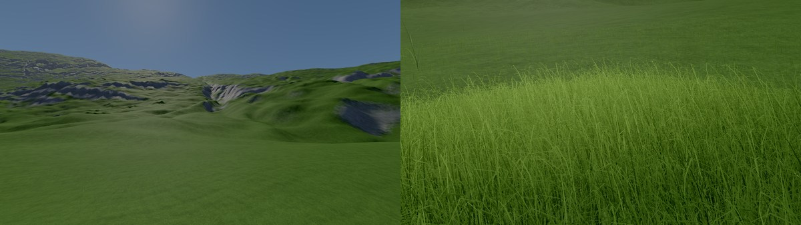

# S1 連續草地與土壤

在 Hellesylt CDLOD 地圖的草甸及可生長坡面，以原模密度作為草地驗收基準。用實拍、掃描和同鏡頭遊戲截圖驗收材質與接地。實物資料附實際來源與適用尺度，現場未知的數值記為模型假設。

## 表土與水

- Hellesylt 地表母質採 © Norges geologiske undersøkelse (NGU) 區域鬆散沉積物分類。按 EPSG:25832 裁切為現有地形邊界，重柵格化為 16 m 採樣。NGU 來源尺度為約 1:100,000–1:500,000。cam 1（6.872755° E、62.084569° N）為河流沉積物，cam 2（6.870350° E、62.083365° N）為崩塌堆積；16 m 是遊戲運算格距。六個測試點在 NIBIO 查不到可用的表土或排水資料。[NGU 資料集](https://data.norge.no/en/datasets/4c8bdb99-68e3-317c-922f-a77d1f21e309/losmasser-regionalt) · [NLOD 1.0](https://data.norge.no/nlod/en/1.0) · [NIBIO Kilden](https://kilden.nibio.no/)
- 土面取 Ground103 的實測影像、法線、粗糙度及高度通道。地形以約 1.2 m 尺度取樣，緩變世界座標偏移打散重複。高度影響微表面著色，粗糙度與法線隨濕潤和水膜改變。1.2 m 是視覺校準，掃描為材質類比。濕潤著色採水分增加後逐漸飽和的反射曲線與水膜折射率約 1.33。[Ground103（CC0）](https://ambientcg.com/view?id=Ground103) · [Lobell 與 Asner 的土壤含水量與反射研究](https://doi.org/10.2136/sssaj2002.7220)
- 河谷與沖積地使用 180 mm 砂質壤土及 300 mm 壤質砂；一般坡面和崩塌類使用 80 mm 砂質壤土及 120 mm 壤土。這些為 Rosetta 類別參數和專案假定層厚。水量在表層、下層及表面三者間轉移，包含入滲、向下滲排、蒸發、八鄰域坡面逕流及窪地積水。正常遊戲由 Worker 每秒更新，傳送水分狀態給材質。有根區深度、兩層含水量和水膜厚度可讀。沙岸、岩壁及石造表面沿用各自地形權重。[Rosetta](https://cales.arizona.edu/research/rosetta/rosetta.html) · [內布拉斯加大學草根剖面參考](https://turf.unl.edu/ianr/agronomy-horticulture/turf/sites/unl.edu.ianr.agronomy-horticulture.turf/files/media/file/2018RootzoneOgranicMatterManagement.pdf)

## 草根與距離

- 以一平方公尺原模的 79,524 葉為面密度，8,836 簇 × 9 片。穩定的世界座標採樣按地形三角形的實際面積建立冠叢，沒有草皮大小的邊界。每葉以自己的原始根部偏移取地形三角形高度，根部插入 2 mm。使用原模的 16 個冠叢樣本，保留 19 點葉形和線性色，套用現場光色、根部遮蔽與原有風場。草花繼續使用各自的物種。
- Medium／High 得到兩層視錐內原模葉簇。最靠近使用九葉，外層使用較疏的固定選樣。連續草絨使用同一原模投影的葉色、高度與葉向，使用 mip 與粗糙度濾除遠處的次像素高頻。Low 由連續材質呈現覆蓋與風向。邏輯草根密度和一幀提交的葉數是兩個可分開量測的值。
- `?sod=full` 是原始整塊草皮的對照模式。一般草地用 `?cam=2&q=med&walk=1`，`?q=low` 檢查 Low。用 `?cam=1&soil=dry&grass=0` 顯示表土，將 `soil` 換成 `rain`（30 mm/h 兩小時）或 `drained`（接著晴天六小時），可在相同光位檢查濕色；移除 `soil` 參數恢復即時雨水。

## 貼地驗收

按工具列的 **6 Grass**、鍵盤 `6`，或開啟 `?cam=6&q=med`，從離地 16 cm 查看 cam 2 腳下同一片即時草地。鏡頭朝地表下看，近裁切面縮至 3.5 cm。Medium 可看原模葉片，Low 可用同鏡頭檢查草絨；按 `2` 回到同地點的站姿。



## 同鏡頭證據


上排是 cam 2，由左至右為 Medium 站姿、Low 比站姿抬升 6 m、Medium 離地 0.11 m。下排為 cam 1 離地 0.42 m 的同光位裸土，由左至右是雨前、2 小時降雨後、再排水 6 小時。Chromium 156／SwiftShader WebGL2，畫布 960 × 540。另以相同 Medium 貼地場景檢查軟體 WebGPU。裸土相機位置的體積含水量依序為 7.1%、16.7%、15.2%，水膜為 0、0.35、0 mm。

`tests/soil-sod.test.ts` 在合成平面與不同坡度上抽測 256 個實際面積一平方公尺的窗口，包含草地內部的格線交界。以冠叢根位換算為 78,561–80,730 葉，各距目標 1.6% 以內。測試另驗證兩剖面的落雨、入滲、排水與總水量守恆，並驗證原模冠叢及逐葉根偏移的資產格式。

範圍截至連續土面、兩層水量與草根接地。地表水膜是 16 m 水量的光學表現。腳印變形、細小積水輪廓、泥土力學和跨工作階段的水分存檔留待接觸系統。遠景可辨認的葉量與攝影級細節、手機 WebGPU 的幀時間及持續負荷仍需驗收。

## 資產重建

```sh
python3 tools/bake-soil.py Ground103_1K-JPG.zip assets/soil
blender -b /tmp/world-unbound-sod/fescue-sod.blend -t 2 --python-exit-code 1 -P tools/bake-sod.py -- crowns assets/grass/sod-crowns.bin
npm test -- tests/soil-sod.test.ts --reporter=verbose
```

土壤烘焙使用 GDAL 與 Pillow，輸入為 [Ground103 1K-JPG 壓縮檔](https://ambientcg.com/view?id=Ground103)。地質裁切範圍、來源網址、授權及色圖尺度寫在 [assets/soil/sources.json](../../assets/soil/sources.json)。正常啟動地圖從本機建置載入資料。診斷草相機的高度和俯角由固定攝影腳本設定，各水相共用相機、晴天天空、13:00 日照與曝光。
